<div align="center">

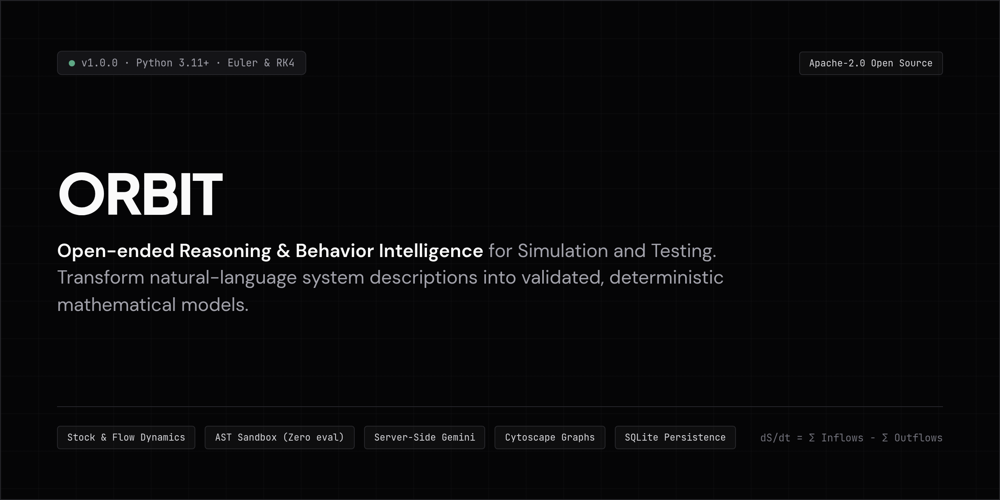

# ORBIT

**Open-ended Reasoning & Behavior Intelligence for Simulation and Testing**

*Transform natural-language system descriptions into validated, deterministic mathematical simulations.*

[](LICENSE)
[](pyproject.toml)
[](package.json)
[](src/App.tsx)
[](tsconfig.json)
[](backend/tests/test_engine.py)
[](docs/SECURITY.md)

[Overview](#overview) &bull;
[Screenshots](#screenshots) &bull;
[How ORBIT Works](#how-orbit-works) &bull;
[Architecture](#system-architecture) &bull;
[Simulation Mathematics](#simulation-mathematics) &bull;
[Quick Start](#quick-start) &bull;
[REST API](#rest-api) &bull;
[Documentation](#documentation) &bull;
[Roadmap](#roadmap)

</div>

---

## Overview

### The Problem

Complex dynamical systems—such as urban infrastructure, ecological food webs, epidemical spread, and energy microgrids—are notoriously counter-intuitive. Small changes in policy parameters frequently cause delayed negative feedback loops, sudden regime shifts, or catastrophic collapse.

Historically, modeling these systems required specialized mathematical formalisms (such as Stella or Vensim) or writing complex numerical integration scripts in Python/Julia from scratch. Conversely, modern Large Language Models (LLMs) can reason about complex scenarios in natural language, but **LLMs cannot reliably perform numerical integration**—they hallucinate numbers, fabricate trajectories, and fail basic conservation laws.

### The ORBIT Solution

ORBIT bridges natural-language reasoning and deterministic mathematics by strictly enforcing a **one-way separation of concerns**:

1. **AI is an Assistant, Not a Calculator**: Google Gemini (`gemini-4-hydrogen`) translates conversational scenario descriptions into strongly-typed, structured model specifications and explains computed results using verified evidence.
2. **Deterministic Python 3.11 Engine**: All numerical integration is executed exclusively by ORBIT's deterministic Python engine using Forward Euler and Runge-Kutta 4th-Order (`rk4`) solvers.
3. **Untrusted-by-Default Validation Gate**: Every equation is parsed through a restricted Python AST allowlist (strictly zero `eval` or `exec`) and checked for algebraic dependency cycles and boundary safety before execution.
4. **Local-First & Offline**: Bundled demonstration models (including the 20-year Urban Ecosystem), visual model editor, Cytoscape graph inspector, and parameter experiment laboratory run 100% locally on standard workstation hardware without an API key.

---

## Screenshots

<div align="center">

### 1. Simulation Workspace with Interactive Time Scrubber & Metrics
*Full-featured 4-panel workstation showing Recharts time-series curves, active parameters, and variable telemetry.*
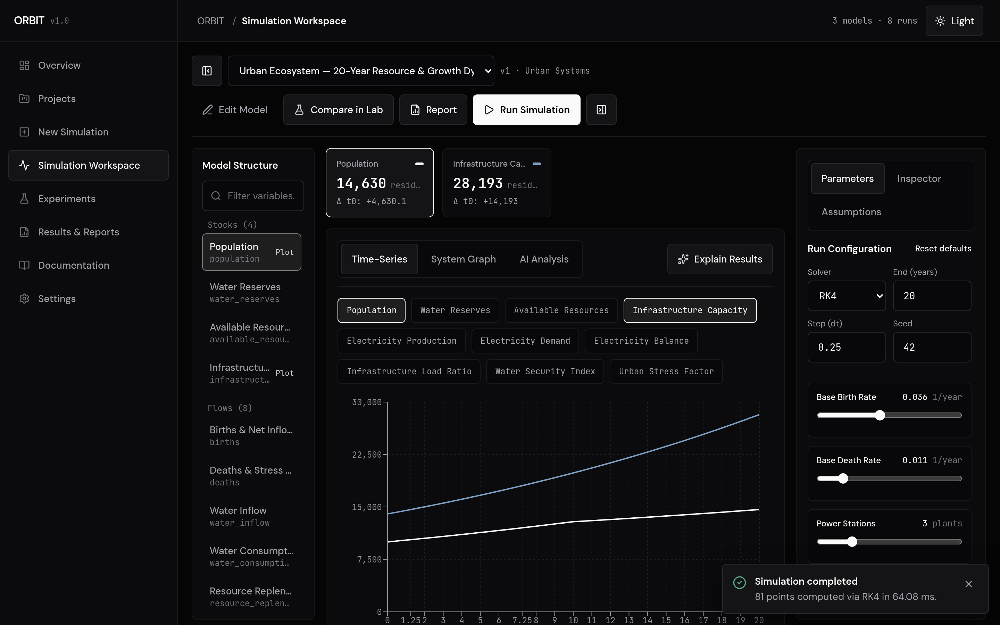

### 2. Directed Stock-and-Flow Dependency Graph
*Cytoscape.js directed graph visualization mapping stocks (rectangles), flows (diamonds), auxiliaries (circles), and parameters (hexagons).*
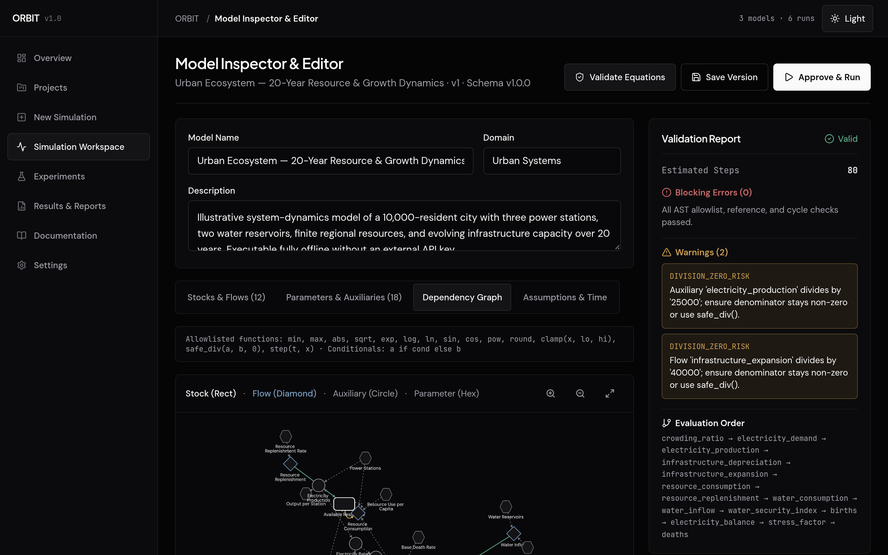

### 3. Non-Destructive Experiment Laboratory
*Baseline vs. alternative parameter comparison testing infrastructure expansion with real-time delta calculations.*
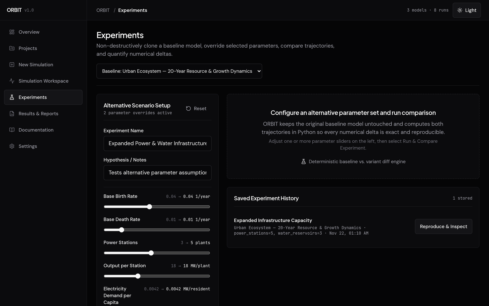

### 4. Natural-Language Scenario Builder
*Server-side Gemini scenario interpretation with targeted clarification loops and AST validation.*
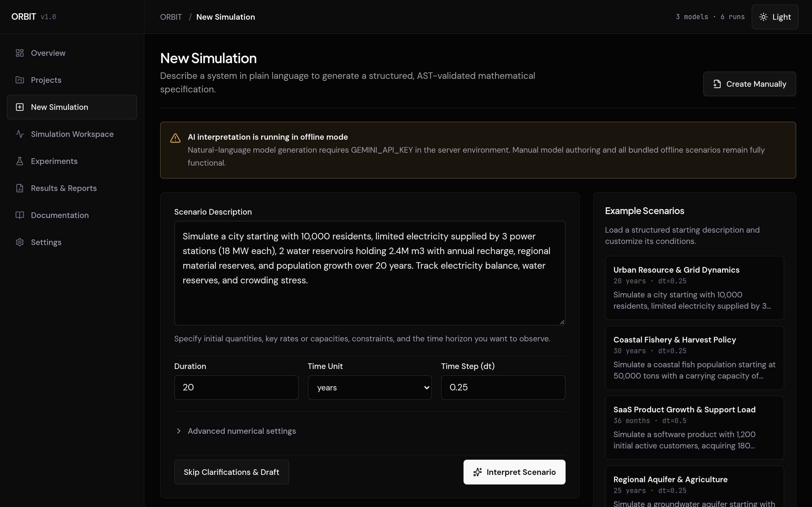

</div>

<details>
<summary><strong>View Additional Application Screenshots</strong></summary>

| View | Screenshot |
| :--- | :--- |
| **Landing Page** | 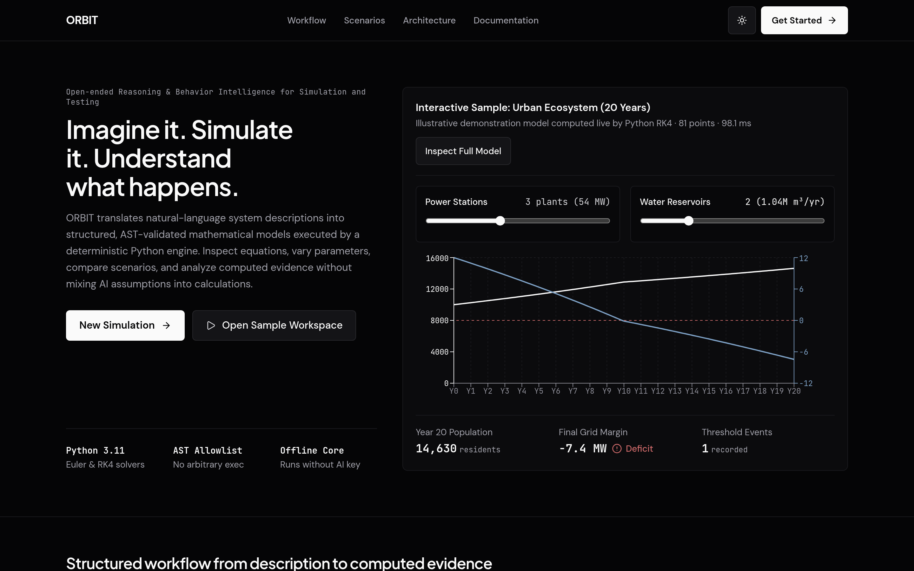 |
| **Main Overview Dashboard** | 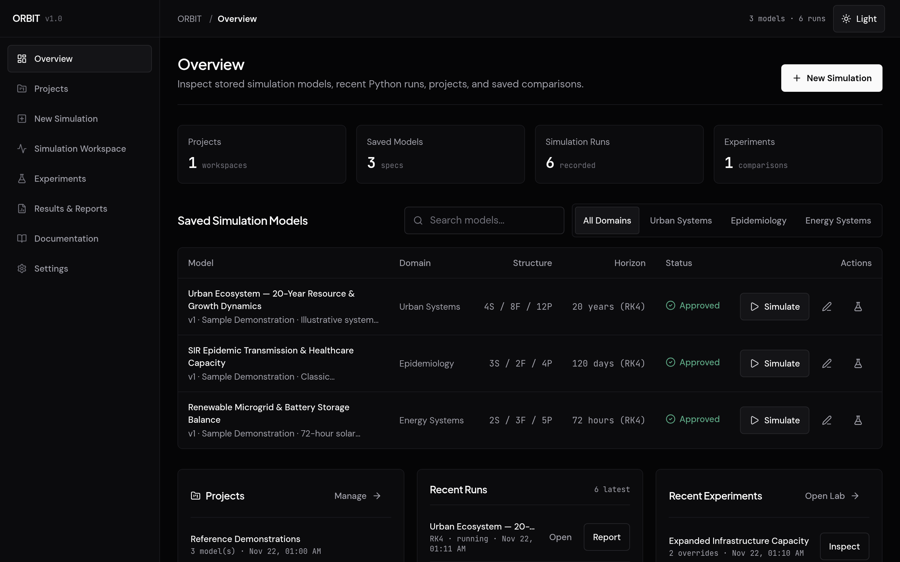 |
| **Model Inspector & Equation Editor** | 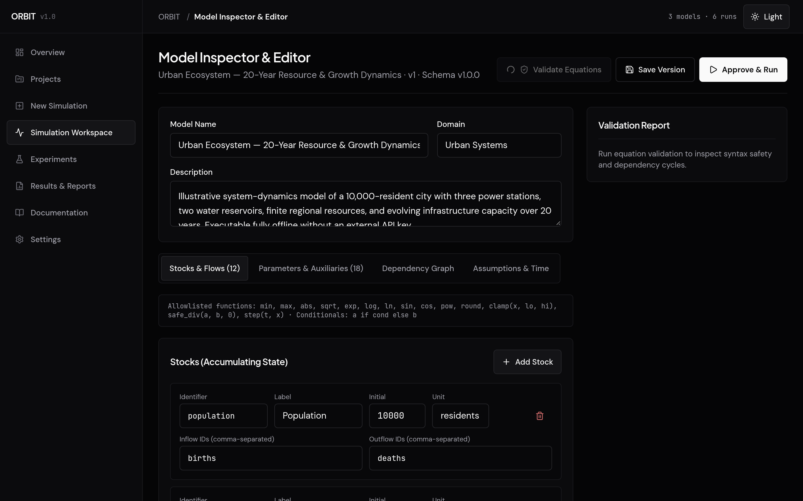 |
| **Scientific Reports & Export Center** | 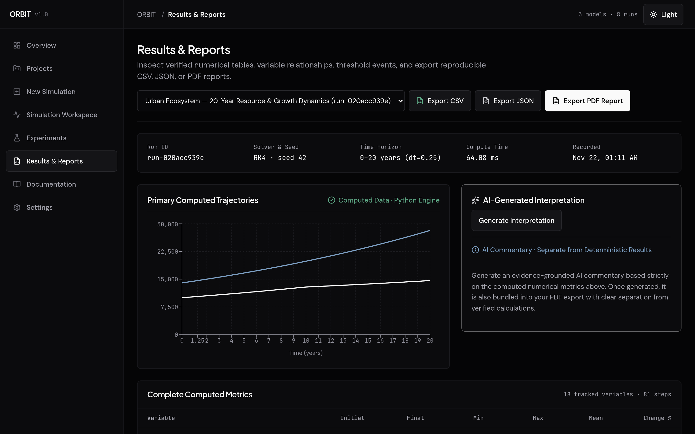 |
| **Interactive Documentation Viewer** | 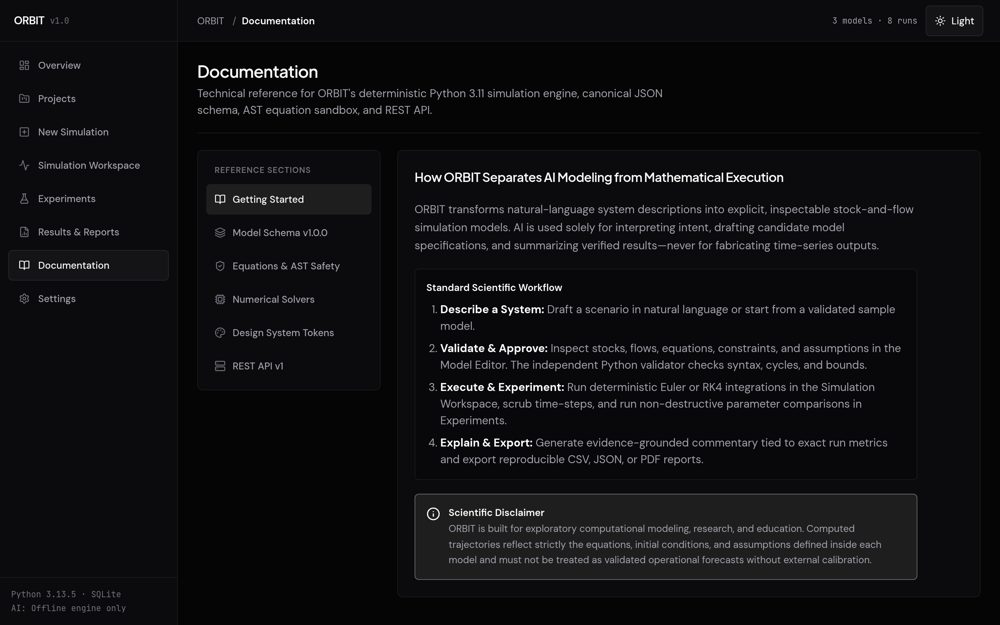 |
| **System Settings & Token Theme Switcher** | 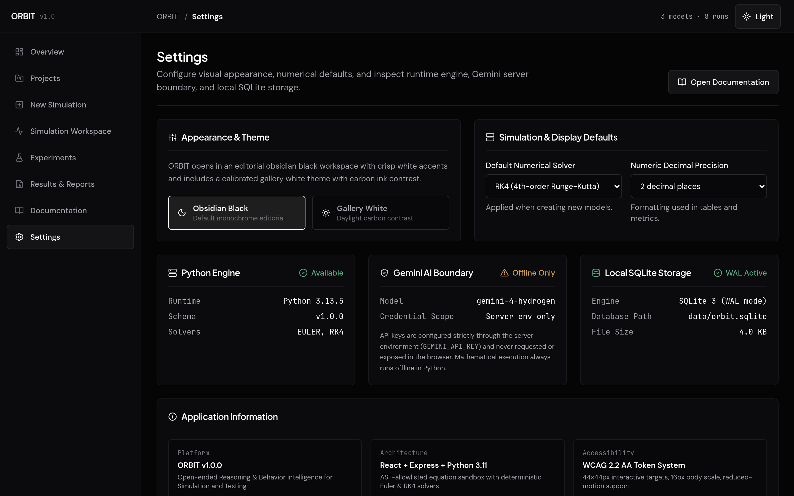 |

</details>

---

## How ORBIT Works

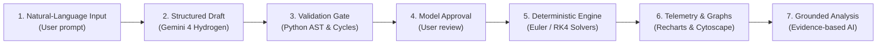

1. **Natural-Language Scenario Description**: The user describes a complex dynamic system (e.g. *"Simulate an urban microgrid with 3 power plants, 2 reservoirs, and 10,000 residents over 20 years"*).
2. **Structured Model Synthesis**: Server-side Gemini formats the scenario into ORBIT's canonical JSON schema (`v1.0.0`), identifying stocks, flows, auxiliary variables, and explicit assumptions.
3. **Untrusted-by-Default Validation**: The candidate specification is sent to the Python engine where all equations are parsed via `ast.parse` allowlists. Kahn's algorithm validates that there are zero algebraic cycles.
4. **Interactive Review & Approval**: The user reviews the model, inspects equations, tunes constants, and approves the model for execution.
5. **Deterministic Integration**: The Python engine computes the trajectories using Euler or RK4 solvers.
6. **Visualization & Inspection**: Trajectories render in Recharts; dependencies display in Cytoscape; parameters can be scrubbed across time.
7. **Evidence-Grounded AI Analysis**: Gemini analyzes computed metrics and threshold events without inventing numbers or extrapolating beyond the simulated horizon.

---

## System Architecture

ORBIT is built as a modular, local-first system optimized for standard CPU execution (4 cores, 8 GB RAM, no GPU required):

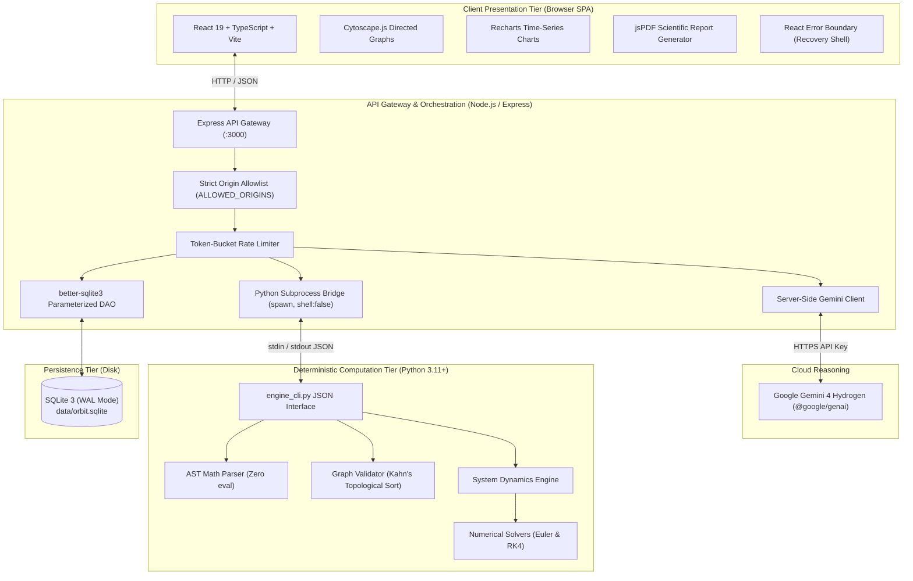

---

## Simulation Mathematics

### Stock-and-Flow Differential Equations

Every stock $S_i(t)$ represents an accumulated state variable governed by the continuous coupled differential equation:

$$\frac{dS_i}{dt} = \sum_{f \in \text{inflows}(i)} F_f(t, \mathbf{S}, \mathbf{A}, \mathbf{P}) - \sum_{g \in \text{outflows}(i)} F_g(t, \mathbf{S}, \mathbf{A}, \mathbf{P})$$

At each integration step:
1. Current stock values $\mathbf{S}$ and static parameters $\mathbf{P}$ populate the environment.
2. Auxiliary variables and flows are evaluated strictly in topological order (computed via Kahn's algorithm).
3. Non-negative flows are clamped at $0.0$, and explicit stock boundaries `[min_value, max_value]` are enforced.

### Numerical Solvers

| Solver | Truncation Error | Global Error | Recommended Use Case |
| :--- | :--- | :--- | :--- |
| **Forward Euler (`euler`)** | $O(\Delta t^2)$ | $O(\Delta t)$ | Fast pedagogical inspection, baseline comparisons, discrete time steps. |
| **Runge-Kutta 4th Order (`rk4`)** | $O(\Delta t^5)$ | $O(\Delta t^4)$ | Coupled non-linear feedback loops, oscillatory regimes, and stiff dynamics. |

### Restricted AST Mathematical Allowlist

To eliminate arbitrary code execution, ORBIT **never** invokes `eval()`, `exec()`, or `compile()`. Equations are parsed into an Abstract Syntax Tree:

- **Allowed Functions**: `min`, `max`, `abs`, `sqrt`, `exp`, `log`, `ln`, `sin`, `cos`, `pow`, `round`, `floor`, `ceil`, `clamp(x, lo, hi)`, `safe_div(num, den, fallback)`, `step(t, threshold)`.
- **Allowed Operators**: `+`, `-`, `*`, `/`, `**`, `==`, `!=`, `<`, `<=`, `>`, `>=`, `a if cond else b`.
- **Strictly Blocked**: Dunder methods (`__class__`, `__mro__`), lambdas, imports, attribute access, loops, comprehensions, and power exponents exceeding $|100.0|$.

---

## Technology Stack

| Layer | Technologies |
| :--- | :--- |
| **Frontend Framework** | React 19, TypeScript 5, Vite 8, Tailwind CSS |
| **Visualization & Graphs** | Recharts (time series), Cytoscape.js (DAGs), Lucide Icons |
| **API Gateway** | Node.js, Express 4.21, TypeScript, `tsx` |
| **AI Integration** | Google Gen AI SDK (`@google/genai`), Gemini 4 Hydrogen |
| **Computational Engine** | Python 3.11+, Pydantic 2, AST sandbox, NumPy |
| **Persistence & Database** | SQLite 3 (WAL mode) via `better-sqlite3` |
| **Export Formats** | CSV, JSON canonical specification (`v1.0.0`), jsPDF scientific reports |

---

## Bundled Offline Demonstrations

ORBIT ships with pre-configured, validated reference models that execute offline without an API key:

1. **Urban Ecosystem Dynamics (`examples/urban_ecosystem/model.json`)**:
   - 10,000 residents over 20 years ($dt=0.25$).
   - Models population growth, 3 power stations (18 MW each), 2 water reservoirs (2.4M $\text{m}^3$), regional material consumption, and infrastructure depreciation.
   - Detects grid blackouts, reservoir depletion, and crowding stress threshold alerts.
2. **SIR Epidemic Dynamics (`examples/epidemic_sir/model.json`)**:
   - 120-day compartmental epidemic transmission across Susceptible, Infected, and Recovered populations.
   - Tracks acute hospital bed utilization and reproduction number $R_0$.
3. **Renewable Microgrid (`examples/renewable_microgrid/model.json`)**:
   - 72-hour solar/wind generation, diurnal demand cycles, battery storage dispatch, and backup thermal $\text{CO}_2$ emissions.

---

## Quick Start

### Prerequisites
- **Node.js**: v20.0.0 or higher (v22 LTS recommended)
- **Python**: v3.11 or higher
- **npm**: v10.0.0 or higher

### 1. Clone & Install
```bash
git clone https://github.com/nani-a11y/orbit.git
cd orbit
npm install
```

### 2. Configure Environment
```bash
cp .env.example .env
```
*(Optional: Configure `GEMINI_API_KEY` in `.env` to enable natural-language scenario generation. All bundled models and simulations run fully offline without an API key.)*

### 3. Launch Development Server
```bash
npm run dev
```
Open **`http://localhost:3000`** in your browser.

---

## Testing & Verification

ORBIT includes an automated test suite verifying analytical convergence and security boundaries:

```bash
# Run Python computational unit tests
npm run test:engine
# or directly:
python3 -m unittest discover -s backend/tests -v

# Run TypeScript type check
npm run lint

# Run production frontend build
npm run build
```

### Genuine Test Results
```
test_blocks_dunder_import_and_eval (test_engine.TestASTMathParserSecurity) ... ok
test_valid_expressions (test_engine.TestASTMathParserSecurity) ... ok
test_deterministic_reproducibility (test_engine.TestKnownAnalyticalSolutions) ... ok
test_euler_matches_discrete_compound_formula (test_engine.TestKnownAnalyticalSolutions) ... ok
test_rk4_matches_exact_exponential (test_engine.TestKnownAnalyticalSolutions) ... ok
test_experiment_override_and_comparison (test_engine.TestUrbanEcosystemDemo) ... ok
test_urban_model_validates_and_runs_offline (test_engine.TestUrbanEcosystemDemo) ... ok
test_detects_algebraic_cycle (test_engine.TestValidationAndCycles) ... ok
test_detects_missing_reference (test_engine.TestValidationAndCycles) ... ok

----------------------------------------------------------------------
Ran 9 tests in 0.173s

OK
```

---

## REST API Reference

All endpoints accept and return `application/json`. State-changing endpoints enforce origin allowlist validation (`ALLOWED_ORIGINS`).

| Method | Endpoint | Description |
| :--- | :--- | :--- |
| `GET` | `/api/v1/health` | Python version, solvers, SQLite status, and Gemini availability. |
| `GET` | `/api/v1/dashboard/stats` | Aggregated counts of models, runs, and comparison experiments. |
| `POST` | `/api/v1/scenarios/interpret` | Gemini natural-language scenario parsing + Python AST validation. |
| `GET` | `/api/v1/models` | List all saved and reference models. |
| `POST` | `/api/v1/models` | Persist a new model specification and initial version snapshot. |
| `GET` | `/api/v1/models/{id}` | Retrieve model specification and immutable version history. |
| `PUT` | `/api/v1/models/{id}` | Validate and persist an updated model version. |
| `POST` | `/api/v1/simulations/run` | Execute deterministic Euler or RK4 integration in Python. |
| `POST` | `/api/v1/simulations/{id}/cancel`| Terminate an active Python subprocess via `SIGTERM`. |
| `GET` | `/api/v1/simulations/{id}/results`| Retrieve computed time-series trajectories and events. |
| `POST` | `/api/v1/experiments` | Run non-destructive baseline vs. variant parameter comparison. |
| `POST` | `/api/v1/analysis/explain` | Evidence-grounded Gemini analysis of computed results. |
| `POST` | `/api/v1/exports` | Export simulation run as bounded CSV or JSON bundle. |

*See [`docs/API.md`](docs/API.md) for complete payload schemas and curl examples.*

---

## Project Structure

```
orbit/
├── backend/                  # Python 3.11 computational engine
│   ├── app/
│   │   ├── models/           # Canonical Pydantic schema v1.0.0
│   │   ├── validation/       # AST math parser & Kahn's DAG cycle validator
│   │   ├── simulation/       # SystemDynamicsEngine, Euler, and RK4 solvers
│   │   ├── engine_cli.py     # JSON stdin/stdout CLI bridge
│   │   └── main.py           # Standalone FastAPI deployment entry point
│   ├── tests/                # Automated numerical unit tests
│   └── requirements.txt      # Python dependencies
├── docs/                     # Technical documentation & architecture papers
│   ├── ARCHITECTURE.md       # Modular monolith & tier design
│   ├── SIMULATION_ENGINE.md  # Numerical methods, error bounds & algorithms
│   ├── MODEL_SCHEMA.md       # Canonical specification definition
│   ├── API.md                # REST API reference and payload contracts
│   ├── SECURITY.md           # Zero eval guarantees & CORS policy
│   ├── ROADMAP.md            # Technical milestones
│   └── assets/screenshots/   # Genuine 1440px application captures
├── examples/                 # Bundled reference models
│   ├── urban_ecosystem/      # 20-year municipal dynamics
│   ├── epidemic_sir/         # Compartmental infectious disease dynamics
│   └── renewable_microgrid/  # 72-hour battery dispatch & grid load
├── server/                   # Node.js backend orchestration
│   ├── db.ts                 # SQLite parameterized data access layer
│   ├── geminiService.ts      # Server-side Gemini scenario interpreter
│   └── pythonBridge.ts       # Subprocess IPC bridge
├── src/                      # React 19 TypeScript frontend
│   ├── components/           # UI primitives, Cytoscape graph, Dialogs, Toast
│   ├── pages/                # Workspace, Dashboard, Editor, Lab, Reports
│   ├── styles/tokens.css     # Monochrome Editorial Minimal design tokens
│   └── types/orbit.ts        # Canonical TypeScript definitions
├── server.ts                 # Express gateway & Vite middleware
├── package.json              # Project dependencies & scripts
└── vite.config.ts            # Vite build configuration
```

---

## Technical Documentation

- [System Architecture](docs/ARCHITECTURE.md)
- [Simulation Engine & Numerical Mathematics](docs/SIMULATION_ENGINE.md)
- [Model Specification Schema (`v1.0.0`)](docs/MODEL_SCHEMA.md)
- [REST API Reference](docs/API.md)
- [Security Architecture & Threat Model](docs/SECURITY.md)
- [Technical Roadmap](docs/ROADMAP.md)
- [Contributing Guidelines](CONTRIBUTING.md)

---

## Roadmap

### Completed (`v1.0.0`)
- [x] Canonical model schema (`v1.0.0`) with SQLite version snapshotting.
- [x] Restricted AST mathematical expression evaluator (zero `eval`/`exec`).
- [x] Deterministic System Dynamics engine with Euler and RK4 solvers.
- [x] Server-side Gemini scenario drafting and clarification workflows.
- [x] Evidence-grounded AI result explanations strictly constrained to computed data.
- [x] Monochrome editorial design token system (`tokens.css`) across all pages.
- [x] Workstation UI: Cytoscape dependency graph, simulation workspace with scrubber, experiment laboratory, and CSV/JSON/PDF exports.
- [x] Explicit environment-based CORS and origin mutation guard (`ALLOWED_ORIGINS`).
- [x] Top-level React Error Boundary with session recovery.

### In Progress (`v1.1.0`)
- [ ] Adaptive step-size Runge-Kutta solver (RK45) with automatic local error estimation.
- [ ] Stochastic noise distributions and Monte Carlo quantile ensemble ribbons.
- [ ] Parameter sensitivity analysis (One-at-a-Time and Sobol variance sweeps).

### Planned (`v1.2.0+`)
- [ ] Concrete Mesa agent-based spatial simulation engine adapters.
- [ ] Automated database schema migration runner.
- [ ] Multi-tenant authentication and Role-Based Access Control (RBAC).

---

## Architectural Scope & Current Limitations

ORBIT is designed for single-tenant research, interactive prototyping, and educational modeling:

1. **Authentication & Multi-Tenancy**: ORBIT does not implement user authentication or RBAC. It assumes deployment on a private local workstation or behind an authenticated reverse proxy / VPN.
2. **Deterministic Solvers**: Current simulation is deterministic (Euler and RK4). Monte Carlo stochastic distributions and spatial agent simulations are defined at the adapter level ([`backend/app/simulation/adapters/base.py`](backend/app/simulation/adapters/base.py)) and scheduled on the roadmap.
3. **Database Migrations**: Persistence uses SQLite with WAL mode and startup declarative table definitions. Upgrading existing schemas currently requires export and re-import.
4. **Network Exposure**: In production, the API gateway validates origins against `ALLOWED_ORIGINS`. Public deployment requires an HTTPS reverse proxy (e.g. Caddy or Nginx).

---

## Scientific Disclaimer

ORBIT is an exploratory computational modeling environment intended for education, research, and systems prototyping. Simulation outputs are derived strictly from the equations and explicit assumptions defined inside each model and are **not** scientifically validated forecasts suitable for safety-critical or high-stakes real-world decision making.

---

## License

This project is licensed under the **Apache License 2.0** — see the [LICENSE](LICENSE) file for details.
