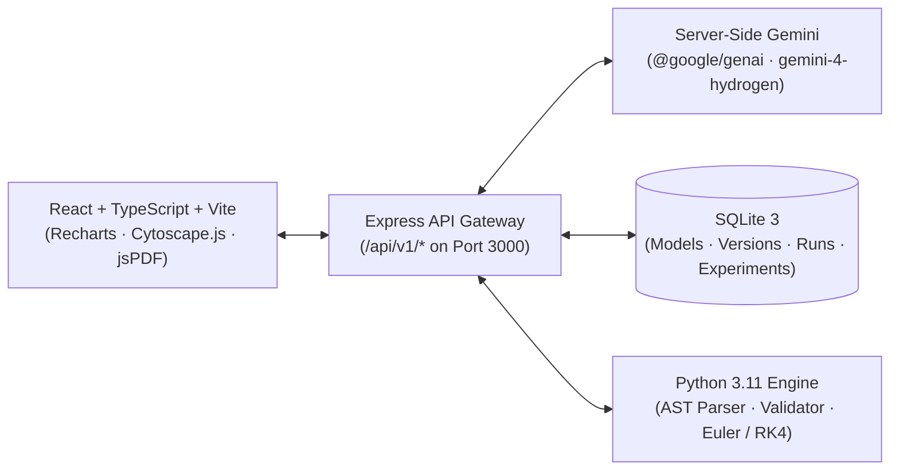

# ORBIT

**Open-ended Reasoning & Behavior Intelligence for Simulation and Testing**

> *Imagine it. Simulate it. Understand what happens.*

ORBIT is an open-source, AI-assisted computational simulation platform that transforms natural-language system descriptions into validated, deterministic mathematical models. Users can inspect equations, explore dependency graphs, execute stock-and-flow numerical simulations in Python, run non-destructive parameter experiments, compare outcomes, and generate AI analyses grounded strictly in computed data.

---

## Core Design Principles

1. **Strict Separation Between AI and Computation**: Gemini translates natural-language scenarios into structured JSON drafts and explains computed results. All numerical integration is performed exclusively by ORBIT's deterministic Python engine.
2. **Untrusted-by-Default Validation Gate**: Every model—whether generated by Gemini or edited by hand—is parsed through a restricted Python AST mathematical allowlist (zero `eval`/`exec`) and validated for reference integrity, algebraic cycles, and numerical stability before execution.
3. **Offline-First Engine**: The mathematical engine, bundled scenarios (including the 20-year Urban Ecosystem), model editor, and experiment laboratory run fully locally without requiring an external API key.
4. **Reproducible Experimentation**: Every model version, run configuration, parameter override, solver choice, and random seed is persisted in SQLite.

---

## Architecture Overview



The repository also includes a standalone FastAPI + Pydantic reference entry point (`backend/app/main.py`) sharing the exact same Python computational modules for direct Python deployments.

---

## Quick Start

### 1. Environment Configuration

Copy `.env.example` to `.env` and optionally configure `GEMINI_API_KEY` for natural-language scenario interpretation and AI result explanations.

### 2. Install & Run

```bash
npm install
npm run dev
```

Open `http://localhost:3000`.

### 3. Run Python Computational Tests

```bash
npm run test:engine
# or directly:
python3 -m unittest discover -s backend/tests -v
```

### 4. Standalone FastAPI Deployment (Optional)

```bash
pip install -r backend/requirements.txt
uvicorn app.main:app --app-dir backend --reload
```

---

## Bundled Offline Scenarios

- **Urban Ecosystem (`examples/urban_ecosystem/model.json`)**: 10,000-resident city over 20 years tracking Population, Water Reserves, Available Resources, Infrastructure Capacity, Electricity Production/Demand/Balance, and crowding stress.
- **SIR Epidemic Dynamics (`examples/epidemic_sir/model.json`)**: 120-day compartmental epidemic transmission and acute hospital bed utilization.
- **Renewable Microgrid (`examples/renewable_microgrid/model.json`)**: 72-hour solar/wind generation, diurnal urban load, lithium-ion storage dispatch, and backup thermal CO2 emissions.

---

## Documentation

- [System Architecture](docs/ARCHITECTURE.md)
- [REST API Reference](docs/API.md)
- [Simulation Engine & Mathematics](docs/SIMULATION_ENGINE.md)
- [Security Design](docs/SECURITY.md)
- [Roadmap & Future Adapters](docs/ROADMAP.md)

---

## Architectural Scope & Current Limitations

ORBIT is designed for single-tenant research, interactive prototyping, and educational modeling:

1. **Authentication & Multi-Tenancy**: ORBIT does not implement user login, sessions, or Role-Based Access Control (RBAC). It assumes deployment on a private local workstation or behind an authenticated corporate reverse proxy / VPN.
2. **Deterministic Numerical Solvers**: The core engine implements numerical integration via 1st-order Forward Euler and 4th-order Runge-Kutta (RK4). Multi-parameter stochastic Monte Carlo sweeps and agent-based spatial simulations are defined at the adapter level (`backend/app/simulation/adapters/base.py`) and scheduled on the roadmap.
3. **Database Migrations**: Persistence uses SQLite with WAL mode and startup declarative table definitions. Upgrading existing database schemas currently requires export and re-import rather than automated migration tooling.
4. **Network Exposure**: In production, the Express API gateway validates origins against `ALLOWED_ORIGINS`. Running on public hosts requires HTTPS termination via a reverse proxy (e.g., Caddy, Nginx, or Cloud Run).

---

## Scientific Disclaimer

ORBIT is an exploratory computational modeling environment intended for education, research, and systems prototyping. Simulation outputs are derived strictly from the equations and explicit assumptions defined inside each model and are **not** scientifically validated forecasts suitable for safety-critical or high-stakes real-world decision making.

## License

Apache License 2.0 — see [LICENSE](LICENSE).
