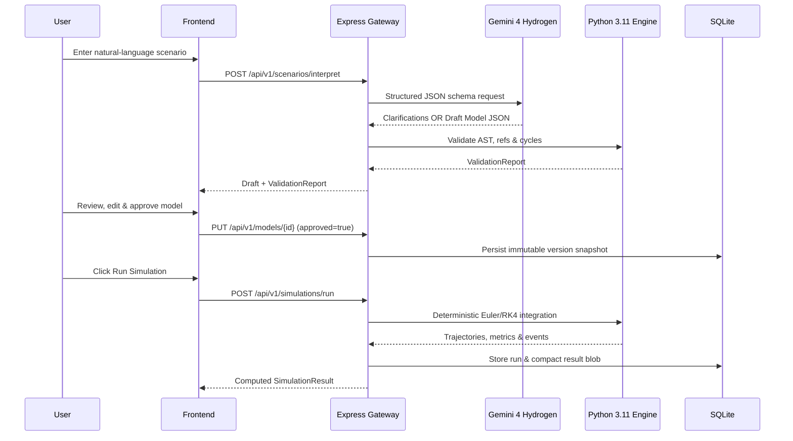

# ORBIT System Architecture

## Modular Monolith Design

ORBIT is built as a modular monolith optimized for local CPU-only execution (4 cores, 8 GB RAM, integrated graphics):

1. **Presentation Layer (`src/`)**: React 19 + TypeScript + Vite SPA styled with Tailwind CSS, Recharts for time-series visualization, Cytoscape.js for stock-and-flow dependency graphs, and jsPDF for scientific report exports.
2. **API & Orchestration Layer (`server.ts`, `server/`)**: Express REST gateway serving `/api/v1/*`, managing SQLite persistence via parameterized prepared statements (`server/db.ts`), orchestrating server-side Gemini structured JSON requests (`server/geminiService.ts`), and spawning isolated Python 3.11 engine subprocesses (`server/pythonBridge.ts`).
3. **Computational Engine (`backend/app/`)**: Pure Python 3.11 modules with zero external runtime dependencies for live execution:
   - `models/schema.py`: Canonical ORBIT model specification (`v1.0.0`)
   - `validation/math_parser.py`: Restricted AST-allowlisted scalar expression evaluator
   - `validation/validator.py`: Independent reference, cycle, stability, and graph validator
   - `simulation/solvers/`: Pluggable `NumericalSolver` interface (`euler.py`, `rk4.py`)
   - `simulation/engines/system_dynamics.py`: Deterministic stock-and-flow engine & comparison delta calculator
   - `simulation/adapters/base.py`: Adapter interface reserved for future Mesa multi-agent & spatial engines
4. **Standalone FastAPI Entry (`backend/app/main.py`)**: Exposes the same core Python modules over FastAPI/Pydantic for standalone Python deployments.

## Core Execution Lifecycle

