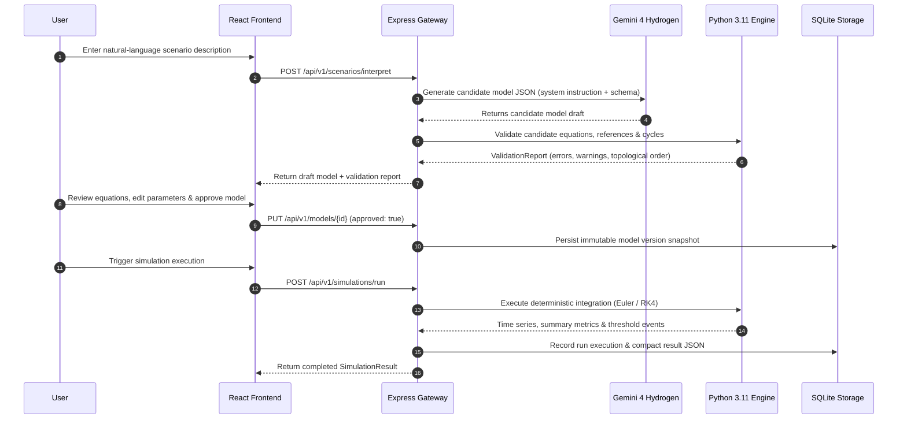

# ORBIT System Architecture

ORBIT is designed as a modular, local-first computational simulation platform optimized for standard workstation hardware (4 CPU cores, 8 GB RAM, no GPU required). It decouples natural-language reasoning (performed by Google Gemini) from deterministic mathematical integration (performed by pure Python 3.11).

---

## 1. Architectural Topology

```mermaid
flowchart TD
    subgraph Client["Client Tier (Browser SPA)"]
        UI["React 19 + TypeScript + Vite"]
        Cytoscape["Cytoscape.js Directed Graphs"]
        Recharts["Recharts Time-Series Charts"]
        PDF["jsPDF Scientific Report Generator"]
        EB["React Error Boundary"]
    end

    subgraph Server["API & Gateway Tier (Node.js / Express)"]
        Express["Express API Gateway (:3000)"]
        CORS["Strict Origin Allowlist Guard"]
        RateLimit["Token-Bucket Rate Limiter"]
        GeminiService["Server-Side Gemini Client"]
        Bridge["Python Subprocess Bridge (spawn)"]
        DBLayer["better-sqlite3 Parameterized DAO"]
    end

    subgraph AI["Cloud AI Tier"]
        Gemini["Google Gemini 4 Hydrogen (@google/genai)"]
    end

    subgraph Engine["Computational Tier (Python 3.11+)"]
        CLI["engine_cli.py JSON CLI"]
        AST["AST Math Parser (Zero eval)"]
        Validator["Graph Validator (Kahn's Topological Sort)"]
        SD["System Dynamics Engine"]
        Solvers["Numerical Solvers (Euler & RK4)"]
    end

    subgraph Storage["Persistence Tier (Disk)"]
        SQLite[("SQLite 3 (WAL Mode)\ndata/orbit.sqlite")]
    end

    UI <-->|HTTP / JSON| Express
    Express --> CORS
    CORS --> RateLimit
    RateLimit --> GeminiService
    RateLimit --> Bridge
    RateLimit --> DBLayer
    GeminiService <-->|HTTPS API Key| Gemini
    Bridge <-->|stdin / stdout JSON (shell:false)| CLI
    CLI --> AST
    CLI --> Validator
    CLI --> SD
    SD --> Solvers
    DBLayer <--> SQLite
```

---

## 2. Core Execution Lifecycle

The lifecycle strictly prevents unverified AI hallucination from contaminating mathematical simulation:



---

## 3. Tier Responsibilities

### Tier 1: Presentation Layer (`src/`)
- Built with **React 19**, **TypeScript**, and **Tailwind CSS**.
- Follows ORBIT's strict **Monochrome Editorial Minimal** design tokens (`src/styles/tokens.css`).
- Time-series plotting powered by **Recharts** with tabular numeric formatting (`font-variant-numeric: tabular-nums`).
- Directed graph visualization of stocks, flows, and auxiliaries rendered with **Cytoscape.js**.
- Client-side scientific reporting export powered by **jsPDF**.
- Protected by a top-level **React Error Boundary** (`src/components/ui/ErrorBoundary.tsx`) providing stack inspection and session recovery.

### Tier 2: Gateway & Orchestration (`server.ts`, `server/`)
- Lightweight **Express 4.21** server running on port `3000`.
- Enforces an explicit, environment-based origin allowlist (`ALLOWED_ORIGINS`) protecting state-changing routes (`POST`, `PUT`, `DELETE`).
- In-memory rate limiting preventing denial-of-service on Gemini calls and integration runs.
- Manages SQLite persistence via prepared statements in `server/db.ts`.
- Coordinates server-side Gemini requests in `server/geminiService.ts`, ensuring credentials never leak to browsers.

### Tier 3: Computational Engine (`backend/app/`)
- Pure **Python 3.11+** with zero required runtime C-extensions for base execution.
- Equation AST parser in `backend/app/validation/math_parser.py` evaluating equations without calling `eval()` or `exec()`.
- Independent model validation in `backend/app/validation/validator.py` detecting missing variable references, algebraic dependency cycles, and domain bounds.
- Numerical integration engine in `backend/app/simulation/engines/system_dynamics.py` implementing 1st-order Euler and 4th-order Runge-Kutta.
- Pluggable adapter interface in `backend/app/simulation/adapters/base.py` designed for future agent-based and spatial simulations.

### Tier 4: Standalone FastAPI Alternative (`backend/app/main.py`)
- Exposes the exact same Python computational modules over FastAPI and Pydantic for pure-Python deployments.
